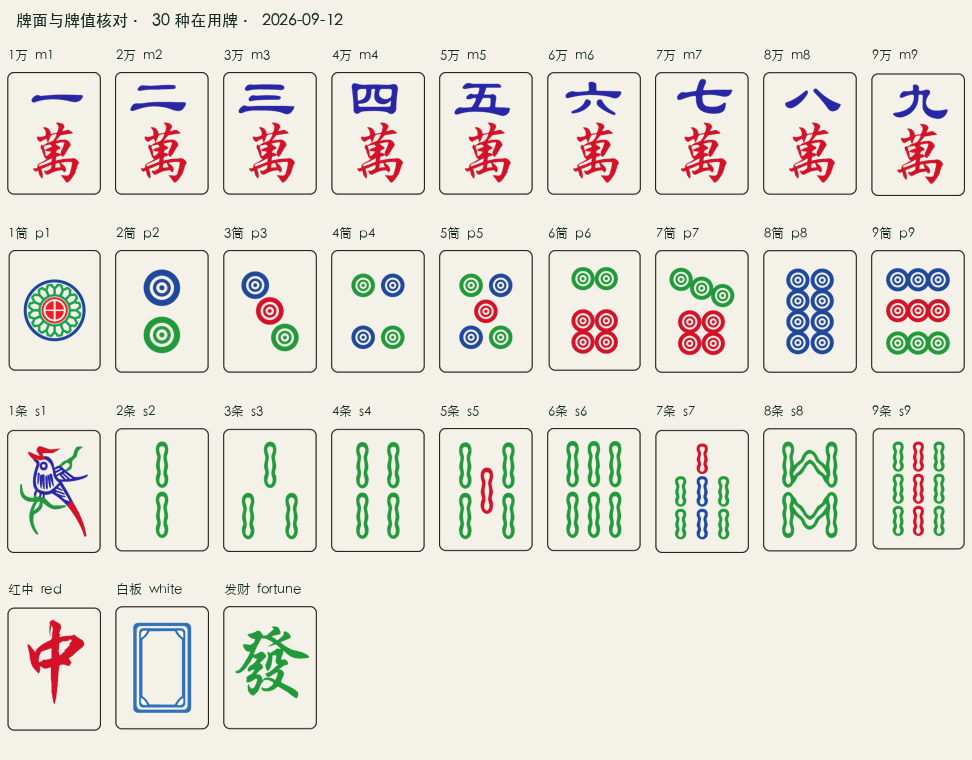

# 牌面与逻辑核查报告

- **核查日期**：2026-09-12
- **对应反馈**：[问题记录](./问题记录.md) 第 16 项，M11.1
- **结论**：在本次核查范围内，未发现 M10 修正以外的新牌面错配；另确认并修复三处逻辑或文案缺陷。完整质量门禁通过。
- **本地提交**：`fix: enforce tile limits and verify tile mappings`（本报告随该提交落盘）

## 1. 核查范围与依据

以 [自定义麻将规则](../自定义麻将规则.md) 为规则依据，从实际 PNG 图案追踪到牌值、名称、合法动作、状态变化、公开视图及结算。范围包括：

| 检查对象 | 数量 / 方法 | 结果 |
|---|---|---|
| 在用牌面 | 万、筒、条各九种，红中、白板、发财，共 30 种 | 图案、名称、花色、点数与排序一致 |
| 原素材裁切 | 42 张现存 PNG 与 `tile-map.json` 记录的原图矩形逐像素比较 | 全部一致；额外四风、八花仅为素材，不进入规则牌库 |
| 牌库 | 30 种 × 四张 | 共 120 张；发财单独亮出，不参与碰杠和胡牌组合 |
| 普通牌动作 | 29 种 × 四座位 × 八类路径，共 928 组 | 摸牌、出牌、碰、明杠、暗杠、补杠、自摸、点炮均对应同一牌值 |
| 发财补牌 | 29 种补牌 × 四座位，共 116 组 | 从墙尾补入正确牌值，发财数量与手牌对应 |
| 摸牌前暗杠 | 29 种 × 四座位，共 116 组 | 暗杠补牌后仍须正常摸牌，不能直接出牌 |
| 边界状态 | 第五张同牌、连续暗杠、补牌后报嘴、普通自摸与杠上开花 | 修复后的状态与合法动作正确 |
| 牌数与视图 | 完整实体牌局；动作节点检查牌数、事件、玩家/观战投影和终局 | 120 张守恒，每种四张；手牌数符合阶段，胡牌张不重复，私有摸牌不外泄 |

八类路径的 928 组是参数化场景组合数，不等同于测试框架报告的测试用例数。专项验收文件有 122 个测试；规则及事件测试另有新增回归。

原图为本地参考素材 `local-docs/imges/majhong.png`，未纳入版本控制；常规回归使用仓库内的 PNG 和已人工核对的内容指纹，不依赖该原图。

## 2. 全牌面核对图

M10 已修正的错位是 `s3` 原先画七条、`s5` 原先画三条、`s7` 原先画五条。本轮复核未发现其他在用牌面错配。

用户原截图的真实牌组为 `45677万、566778筒、389条`，不能胡；三条换成七条时，可拆成 `456万 / 567筒 / 678筒 / 789条 / 77万`。这一对照已加入长期规则回归。

## 3. 确认并修复的缺陷

### 3.1 第五张同牌被算作胡牌张和听口

例如手中为 `1111万 + 234567筒 + 789条`，原判定会把不存在的第五张一万当作听口；达到三张发财后，还会错误提供报嘴动作。碰出的三张与暗手中的同牌原来也未合并计数。

修复后，[rules.ts](../src/rules.ts) 在拆分牌型前合计暗手与所有碰杠中的实体牌数：碰为三张，杠为四张，任意牌超过四张即不可胡。听牌、报嘴共用该判断；合法的第四张仍可组成胡牌。

此处检查的是玩家暗手与碰杠的四张上限，不将已经公开打尽的听口作为新房规剔除；当前规则未规定死听处理。

### 3.2 普通摸牌日志误写为补摸

原状态事件类型可以是 `draw`，但文字固定写“补摸”，容易让玩家误解摸牌来源。

修复后，[game.ts](../src/game.ts) 用同一来源判断生成类型与文字：普通摸牌记录“摸到”，发财或杠后补牌记录“补摸”。覆盖所有普通牌值及四座位，并单独对照普通、杠后、发财三种来源。

### 3.3 摸牌前暗杠漏掉本回合正常摸牌

非庄家等处于待摸牌阶段的玩家，原先可以宣布暗杠，但补牌后直接进入出牌阶段。此时暗手 10 张加一副杠，只相当于 13 张手牌；再出一张会永久少牌。

修复后，按暗手加每副面子三张的手牌数判断是否仍欠正常摸牌：摸牌前暗杠先从墙尾补牌，随后回到正常摸牌阶段；连续暗杠逐次补牌，正常摸牌只执行一次。正常摸牌完成后再杠，仍在补牌后进入出牌或胡牌阶段。

同时核对补牌后报嘴资格：三财且补成听牌时，可先报嘴，再正常摸牌；报嘴后摸到胡牌张必须胡。杠后补牌成胡记录 `gang-draw`，随后正常摸牌成胡记录 `normal`。

## 4. 浏览器与自动化验收

浏览器使用 1280×720 的隔离验收页面，复用实际牌面、牌桌组件和规则引擎：

- 30 种牌 × 普通/紧凑两种展示，共 60 张图片加载成功，无页面横向溢出。
- 截图牌组含三条时没有胡牌按钮，换七条后有；实际点击胡牌后四家亮牌，仅有一个“胡牌张 7万”标记，一财自摸得分为 +6。
- 三财且持四张同牌的错误听口场景，不显示报嘴按钮，仍可暗杠或摸牌。
- 上述浏览器检查无控制台错误，临时验收页面和标签页均已清理。

最后发现并修复的摸牌前暗杠流程，通过了 116 组四座位自动化及连续暗杠、报嘴和胡牌原因回归。追加浏览器点击复查时电脑锁屏，未完成该项人工点击验收；不将前面的浏览器结果计作此流程的验收证据。

最终执行 `npm run quality`，结果为：

| 检查 | 结果 |
|---|---|
| 格式、仓库卫生 | 通过；新增文件暂存后再次执行仓库卫生检查 |
| 引擎、Web、服务端 TypeScript | 全部通过 |
| 覆盖率测试 | 32 个文件，357 个测试通过 |
| 原有 M2 专项验收 | 6 个场景通过 |
| 引擎、Web、服务端生产构建 | 全部通过，Web 为 58 个模块 |
| Statements / Branches | 77.94% / 73.71% |
| Functions / Lines | 80.03% / 80.67% |
| 核心 `src/` Lines | 93.59% |

完整测试包含 AI 模拟、权威房间、真实 HTTP/WebSocket、回放和隐私投影的既有回归。以上结果说明本次覆盖范围内未见其他失败，不代表穷尽所有牌局组合。

## 5. 后续维护

1. [tile-face-reference.json](../web/acceptance/tile-face-reference.json) 保存每张在用牌的名称、花色、点数、SHA-256 和裁切矩形。测试从实际牌面组件输出的图片 URL 读取文件并核对内容，不仅检查文件名。
2. 替换素材时先逐张目视核对图案和牌值，再更新裁切记录、指纹与本核对图；不能用脚本自动接受所有新指纹来消除测试失败。替换既有资源同时更新缓存版本。
3. [tileMapping.acceptance.test.tsx](../web/acceptance/tileMapping.acceptance.test.tsx) 使用真实 120 张牌构造四人局面，检查全桌牌数及各阶段手牌数。新增动作边界时沿用这一完整牌库约束，避免不可能的测试手牌掩盖缺陷。
4. 规则边界见 [rules.test.ts](../src/rules.test.ts)，摸牌事件来源见 [game.test.ts](../src/game.test.ts)。修改牌面、牌值或摸打碰杠胡逻辑后执行 `npm run quality`。

本次保持版本 1.0.0，变更记录在 Unreleased，仅创建本地提交。部署及历史发布准备范围另见 [发布验收报告](./发布验收报告.md) 第 12 节。
